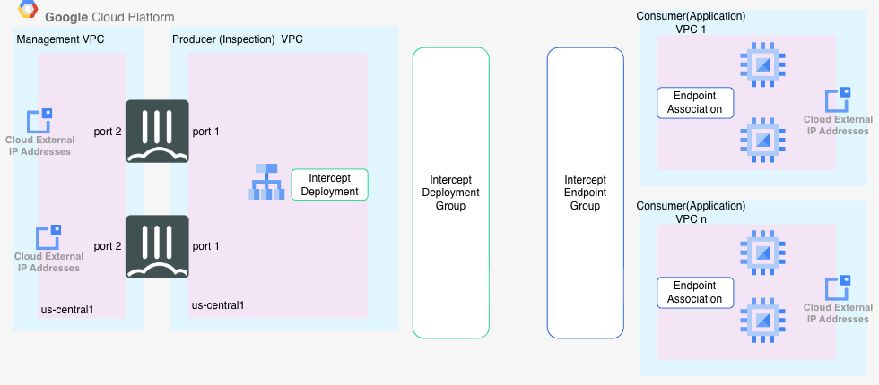

## Solution Description

This solution uses Google Cloud Network Security Integration (NSI) to steer traffic from workload VPCs to FortiGate VMs for inspection. Terraform builds the FortiGate inspection infrastructure. A separate `setup-nsi.sh` step creates the NSI resources and associates them with the VPCs whose traffic you want to inspect.

The [Terraform configuration and full README](https://github.com/FortinetCloudCSE/GCP_Solutions/tree/main/terraform/gcp-nsi-umig) are in `terraform/gcp-nsi-umig`.

Google calls this an [in-band integration](https://docs.cloud.google.com/network-security-integration/docs/in-band/in-band-integration-overview): matching packets enter the inspection path before reaching their destination, without changing the workload VPC's routes. The FortiGate infrastructure is the **service producer**; each workload VPC associated with it is a **service consumer**.

## How Traffic Reaches the FortiGates

1. A global network firewall policy on each associated workload VPC uses the `apply_security_profile_group` action to select ingress and egress traffic for inspection.
2. The security profile group contains a custom intercept security profile. That profile references an intercept endpoint group, which points to the producer's intercept deployment group. Each workload VPC also needs an association with that endpoint group.
3. A deployment in each configured zone points to a forwarding rule for an internal UDP load balancer on port 6081. Google Cloud intercepts matching egress packets before routing and matching ingress packets after routing, then sends them to the producer using GENEVE encapsulation. The original packet's source and destination addresses are preserved inside the encapsulated packet.
4. The load balancer sends traffic to healthy FortiGate backends. Its regional backend service uses client IP session affinity and a health check on port 8080. When the FortiGate permits a packet, it re-encapsulates and returns it to the consumer using direct server return.

Interception requires the firewall policy and endpoint group to be associated with the consumer VPC. The security profile used by the rule must reference that associated endpoint group. A firewall rule alone does not steer packets if these resources are mismatched. Intercept rules track sessions; intercepted TCP connections must start with a SYN packet. Unknown non-SYN packets are dropped. See Google's [in-band integration overview](https://docs.cloud.google.com/network-security-integration/docs/in-band/in-band-integration-overview) for the full packet flow and requirements.

Each configured zone has one FortiGate VM in an **unmanaged instance group**. The default `zones` list has three zones. The FortiGates have an inspection interface in the inspection VPC and a management interface with an external IP in the management VPC. Cloud NAT provides internet egress for the inspection interface.

## Resources Deployed

| Component | Purpose |
| --- | --- |
| Inspection VPC and subnet | Carries the FortiGate data interfaces; the default subnet is `10.50.160.0/24`. |
| Management VPC and subnet | Carries the management interfaces; the default subnet is `10.50.180.0/24`. |
| FortiGate VMs and unmanaged instance groups | One VM and one group per zone, with no autoscaling configured. |
| Internal UDP load balancer | Regional backend service, health check, and a reserved frontend IP and forwarding rule for each zone. |
| Cloud Router and Cloud NAT | Internet egress from the inspection VPC for FortiGate services and updates. |
| Optional demo workload | Two peered web VPCs (`10.12.0.0/24` and `10.13.0.0/24`) with Debian web servers running Apache and iperf3. |

Terraform enables the Compute Engine, Network Security, and Cloud Resource Manager APIs. After Terraform completes, `setup-nsi.sh` creates the intercept deployment group, zone deployments, endpoint group, custom intercept security profile, security profile group, and global network firewall policy. It then associates the endpoint group and policy with the demo VPCs and any VPCs named in `CONSUMER_NETWORKS`.

Google Cloud supports direct internet egress through an appropriately configured inspection appliance, but this sample's Cloud NAT serves the FortiGate inspection interface for services and updates. Plan internet egress for your workload VPCs separately. Packet Intercept also adds packet processing overhead, and regional network firewall policies do not support it. See the [Google Cloud limitations](https://docs.cloud.google.com/network-security-integration/docs/in-band/in-band-integration-overview#limitations).

## Deploy the Sample

You need a Google Cloud project with billing, an organization ID, permissions to create resources in the project and organization, Terraform 1.1 or later, Google Cloud CLI (`gcloud`), and `jq`. Authenticate `gcloud` and Terraform for the target project before deploying.

```sh
git clone https://github.com/FortinetCloudCSE/GCP_Solutions.git
cd GCP_Solutions/terraform/gcp-nsi-umig
cp terraform.tfvars.example terraform.tfvars
```

Edit `terraform.tfvars` with your `project_id`, `organization_id`, deployment region and zones, and a strong `admin_password`. Check the FortiGate image and license settings. The example selects the latest `fortigate-76-payg` image family; `fortigate_vm_image` can pin a specific image. The default configuration deploys three FortiGates and the demo workload.

```sh
terraform init
terraform plan
terraform apply
PROJECT_ID=your-gcp-project-id ORGANIZATION_ID=123456789012 ./setup-nsi.sh
```

`terraform apply` alone does not finish the NSI setup. Run the script from the Terraform directory so it can read the Terraform outputs. The FortiGate management addresses are available in the `fortigate_instances` output. Open `https://<management_ext_ip>:8443` and sign in as `admin` with the configured password.

Spend some time looking through the outputs created by terraform.  If needed, you can type `terraform output` from the prompt while in the `terraform/gcp-nsi-umig` folder.  There is a lot of useful information contained there.  Included are the 9 steps (with gcloud commands) required to deploy the remainder of the NSI solution.  These are not needed if you plan to use the `setup-nis.sh` script, which is the recommended method.

### Routing And VPC Firewall

This document assumes that you have deployed the entire terraform script, including the WebServers and their VPC networks ('deploy_web_servers = true'). We will discuss the underlying Routing and Firewalls that were created.

#### Routing

> **Note:** NSI inspects traffic on Ingress (destined to a VM in a consumer network) and Egress (sourced from a VM in a consumer network).  In the case of Egress traffic, all inspection is done prior to any NAT or Routing decision.  Traffic is intercepted, inspected and sent back to the Consumer VPC, where those operations are completed and the packet is forwarded to the destination.  The reverse is true for Ingress traffic.  This means that consumer networks must have underlying routes to the internet or remote VPCs. Traffic routing between VPCs can be governed by VPC Peering (as in our example) or using Network Connectivity Center (NCC).

##### Consumer VPCs

The below route table shows the deployed routes in the "web" VPC.

| **Status** | **Name** | **Type** | **IP version** | **Destination IP range** | **Priority** | **Scope limits** | **Next hop** |
| :---: | --- | --- | --- | --- | ---: | --- | --- |
| | [default-route-8f0c00007256a42a](https://console.cloud.google.com/networking/routes/details/default-route-8f0c00007256a42a?project=dgooch-fortiedr-demo) | Static | IPv4 | 0.0.0.0/0 | 1000 | — | Default internet gateway |
| | [default-route-r-83647e0f53ba3bde](https://console.cloud.google.com/networking/routes/details/default-route-r-83647e0f53ba3bde?project=dgooch-fortiedr-demo) | Subnet | IPv4 | 10.12.0.0/24 | 0 | — | Network [nsi-fgt-nsi-ib-new-web](https://console.cloud.google.com/networking/networks/details/nsi-fgt-nsi-ib-new-web?project=dgooch-fortiedr-demo) |
| | [peering-route-3acc4db63572a940](https://console.cloud.google.com/networking/routes/details/peering-route-3acc4db63572a940?project=dgooch-fortiedr-demo) | Peering subnet | IPv4 | 10.13.0.0/24 | 0 | — | Network peering [nsi-web-to-web2-peering](https://console.cloud.google.com/networking/peering/details/nsi-fgt-nsi-ib-new-web/nsi-web-to-web2-peering?project=dgooch-fortiedr-demo) (network [nsi-fgt-nsi-ib-new-web2](https://console.cloud.google.com/networking/networks/details/nsi-fgt-nsi-ib-new-web2?project=dgooch-fortiedr-demo)) |

###### Egress
**Internet Routing**
As you can see, there is a default (0.0.0.0/0) route pointing to the default internet gateway.  Each of the VMs deployed has been given a public IP address.  Below are the steps a packet follows when going to the internet from a VM in a consumer VPC while NSI is configured:

1. Traffic leaves virtual NIC on VM and is passed to the Andromeda network stack
1. With `BEFORE_CLASSIC_FIREWALL` set on the consumer VPC, traffic is evaluated against the global NSI policy before the classic VPC firewall rules.
1. Traffic matches the NSI policy and is encapsulated in GENEVE and forwarded to the PassThrough Network Load Balnacer (NLB) in the Producer network
1. The NLB forwards the encapsulated traffic to a back end FortiGate
1. If FortiGate policy allows the traffic, inspection is completed and FortiGate re-encapsulates the traffic in GENEVE and forwards it back to the originating VM (Direct Server Return)
1. Traffic is then routed to the default internet gateway
1. Finally, Source NAT is applied, using the Public IP assigned to the VM and traffic is forwarded to the internet destination

**Remote VPC Routing**
Traffic destined for the "web2" VPC will follow all of the same steps as highlighted above, except that instead of being forwarded to the internet, it will be sent via the VPC peering connection.  If Private NAT is configured for the VPC, it will be applied during the final step before forwarding to the remote VPC.

###### Ingress

**Inbound from Internet**
Traffic inbound from the internet wi follow the below steps when NSI is configured:
1. Destination NAT is completed and a routing lookup determines that the new destination IP address is associated with the virtual NIC associated with the Destination VM
1. With `BEFORE_CLASSIC_FIREWALL` set on the consumer VPC, traffic is evaluated against the global NSI policy before the classic VPC firewall rules.
1. Traffic matches the NSI policy and is encapsulated in GENEVE and forwarded to the PassThrough Network Load Balnacer (NLB) in the Producer network
1. The NLB forwards the encapsulated traffic to a back end FortiGate
1. If FortiGate policy allows the traffic, inspection is completed and FortiGate re-encapsulates the traffic in GENEVE and forwards it back to the consumer VPC Network
1. The traffic is de-encapsulated and sent to the destination VM.

**Remote VPC Ingress** traffic is handled in the same fashion.

#### Firewall Hierarchy

Google Cloud evaluates hierarchical firewall policies and regional system firewall policies first. The consumer VPC's **network firewall policy enforcement order** controls where its global network firewall policy sits relative to classic VPC firewall rules:

| Enforcement order | Evaluation order after hierarchical and regional system policies |
| --- | --- |
| `AFTER_CLASSIC_FIREWALL` (default) | Classic VPC firewall rules → global network firewall policy → regional network firewall policies → implied rules |
| `BEFORE_CLASSIC_FIREWALL` | Global network firewall policy → regional network firewall policies → classic VPC firewall rules → implied rules |

The sample's `setup-nsi.sh` creates a **global network firewall policy** with an ingress rule at priority 10 and an egress rule at priority 11. Both use `APPLY_SECURITY_PROFILE_GROUP` to send matching traffic to the FortiGate inspection service. A matching `allow` or `deny` rule at an earlier evaluation step stops evaluation before NSI; a matching NSI rule also stops further firewall rule evaluation, and the inspection service decides whether to allow or drop the packet. See Google's [firewall evaluation order](https://docs.cloud.google.com/firewall/docs/firewall-policies-rule-eval-order) and [NSI firewall policy actions](https://docs.cloud.google.com/network-security-integration/docs/in-band/firewall-policies-overview).

**Set `BEFORE_CLASSIC_FIREWALL` on every consumer VPC.** The Terraform sample creates broad classic allow rules for the web and web2 VPCs, and neither Terraform nor `setup-nsi.sh` currently changes their default enforcement order. At the default order, those allow rules can match first and bypass the global NSI rule. For the demo VPCs created with `prefix = "nsi"`, run:

```sh
gcloud compute networks update nsi-fgt-nsi-ib-new-web --project=dgooch-fortiedr-demo --network-firewall-policy-enforcement-order=BEFORE_CLASSIC_FIREWALL
gcloud compute networks update nsi-fgt-nsi-ib-new-web2 --project=dgooch-fortiedr-demo --network-firewall-policy-enforcement-order=BEFORE_CLASSIC_FIREWALL
```

Apply the same setting to any additional consumer VPC. Google lists it as a step when [configuring NSI consumer services](https://docs.cloud.google.com/network-security-integration/docs/in-band/configure-consumer-service).

### Inspect Your Own pre-existing VPCs

Set `deploy_web_servers = false` in `terraform.tfvars` to omit the demo VPCs and servers. Supply workload VPC names from the same project when running the setup script:

```sh
CONSUMER_NETWORKS="prod-vpc,staging-vpc" PROJECT_ID=your-gcp-project-id ORGANIZATION_ID=123456789012 ./setup-nsi.sh
```

You can also use `CONSUMER_NETWORKS` alongside the demo VPCs. The script checks that each network exists and rejects the FortiGate inspection and management VPCs. Existing associations are skipped on a rerun.

**Review the policy before associating a production VPC.** The sample firewall policy applies its security profile group to all ingress and egress traffic (`0.0.0.0/0`) in every associated VPC. The Terraform sample also creates permissive VPC firewall rules, including management ingress. Restrict these rules for your environment. A VPC that already has a global network firewall policy cannot be associated with the sample policy by the setup script.


## Cleanup

Remove the NSI associations and resources before destroying the Terraform infrastructure. Run this from the Terraform directory, so that it can read the Terraform outputs.  If you ran the script "manually" by inputting existing consumer networks, Pass the same `CONSUMER_NETWORKS` list used during setup:

```sh
CONSUMER_NETWORKS="prod-vpc,staging-vpc" PROJECT_ID=your-gcp-project-id ORGANIZATION_ID=123456789012 ./cleanup-nsi.sh
terraform destroy
```

Omit `CONSUMER_NETWORKS` if you did not use it. The cleanup script stops if it finds associations it cannot account for; include those networks before rerunning it.
