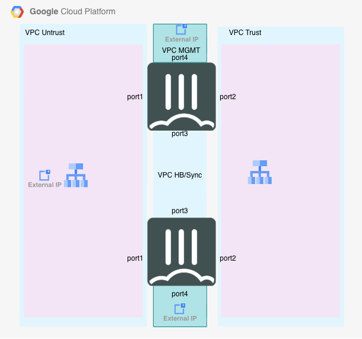

## Solution Description

This sample deploys a FortiGate active-passive HA pair across two Google Cloud zones. Both VMs have four interfaces, each in a separate VPC: untrust (`port1`), trust (`port2`), HA heartbeat (`port3`), and management (`port4`). FortiGate HA uses a unicast heartbeat over `port3` and enables session pickup. Only the active unit is intended to process application traffic.

An external passthrough load balancer provides a public frontend for inbound traffic. An internal passthrough load balancer receives traffic from the trust VPC; a custom `0.0.0.0/0` route points that VPC to the internal load balancer. Both load balancers have the two FortiGates as backends and use an HTTP probe on port `8008` by default. The FortiGate bootstrap configuration supplies the probe response. A failover depends on FortiGate HA election and load balancer health detection, so existing sessions should be tested for your applications even though session pickup is enabled.

The [Terraform source and full README](https://github.com/fortidg/gcp-fgt-a-p-new) are in `terraform/gcp-fgt-a-p-new`.

## Resources Deployed

| Component | Purpose |
| --- | --- |
| Four VPCs and subnets | Separate untrust (`10.0.1.0/24`), trust (`10.0.2.0/24`), HA (`10.0.3.0/24`), and management (`10.0.4.0/24`) traffic by default. |
| Two FortiGate VMs | One per configured zone, each with four interfaces and a 30 GB log disk. |
| Two unmanaged instance groups | One FortiGate per group, used by both load balancers. |
| External and internal passthrough load balancers | Each has a regional backend service and forwarding rule; both share a regional HTTP health check. |
| Reserved addresses | External frontend IP, internal frontend IP, two public management IPs, a Cloud NAT IP, and private interface IPs. The untrust data interfaces have no public IPs. |
| Trust VPC default route | Sends `0.0.0.0/0` traffic to the internal load balancer. |
| Cloud Router and Cloud NAT | Provide NAT on the untrust VPC. |
| VPC firewall rules | Permit traffic needed by the sample, including health probes. The supplied rules broadly allow traffic and need review before production use. |

The sample bootstrap configuration creates an outbound FortiGate policy from `port2` to `port1`. Add policies for any inbound applications you intend to publish through the external load balancer. The sample's outbound policy does not enable FortiGate source NAT; verify the return path and NAT behavior for your workloads.

## Deploy the Sample

Use a Google Cloud project with billing enabled and permissions to create Compute Engine networking, VM, and load balancing resources. Choose two zones in the same region for zone-level resilience. From a shell with Terraform and Google Cloud credentials configured:

```sh
git clone https://github.com/fortidg/gcp-fgt-a-p-new.git
cd gcp-fgt-a-p-new
cp terraform.tfvars.example terraform.tfvars
```

Edit `terraform.tfvars` with your `project`, `region`, `zone`, `zone2`, `prefix`, `fortigate_machine_type`, and strong `fgt_password` and `ha_password` values. Choose a license type and supply the corresponding FortiFlex tokens or BYOL license files when needed. Keep the image license type aligned with the chosen license: Flex and BYOL use a BYOL image; PAYG uses a PAYG image. The default `fortigate_version = "latest"` selects the newest matching image at plan time; set a version family or `fortigate_vm_image` if you need a fixed release.

```sh
terraform init
terraform plan
terraform apply
terraform output
```

The `fgt1_ip` and `fgt2_ip` outputs contain management URLs on port `8443`. The `elb_ip` and `ilb_ip` outputs show the load balancer frontends. The `fgt_password` output contains the configured administrator password, so protect Terraform state and command output.

### Optional settings

`enable_loopback = true` moves the external load balancer's probe address from a secondary IP on `port1` to FortiGate `lo0`. `enable_fips_ciphers = true` enables FortiGate FIPS cipher mode. Both default to `false`. FIPS cipher mode is not full FIPS-CC mode or a certification of the deployed VM, and it does not constrain IPsec phase 2 proposals. Review and explicitly set both phases for any IPsec tunnels you add.

The sample also supports custom VPC names, subnet CIDRs, and trust interface alias IP ranges. Review the [README](https://github.com/fortidg/gcp-fgt-a-p-new#readme) and `terraform.tfvars.example` before changing these settings.

## Validate Failover

After deployment, check the FortiGate HA status and the health of each load balancer backend. Verify that traffic reaches the active FortiGate. Test traffic from a workload in the trust VPC through the internal frontend, then test any inbound application policy you added through the external frontend. Trigger a controlled HA failover and verify load balancer health, new connections, and existing application sessions.

## Cleanup

From the Terraform directory, run `terraform destroy` when you no longer need the sample resources.
